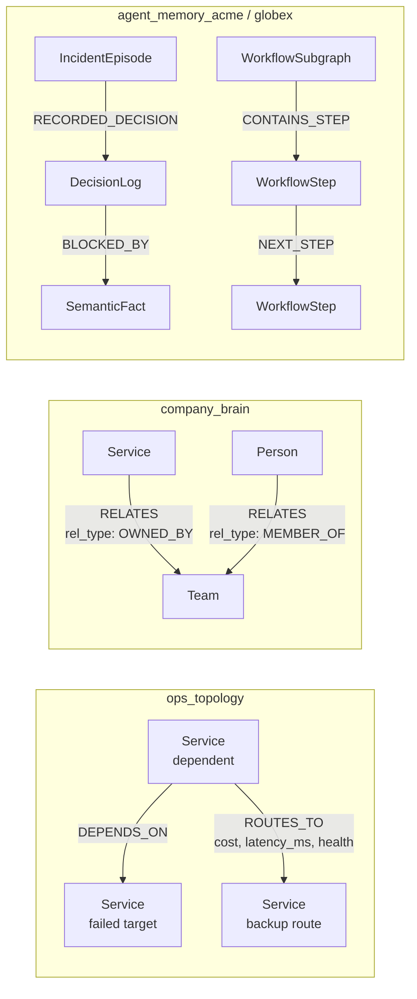

# ChronosOps

> **Graph-grounded incident intelligence: understand service ownership, investigate simulated outages, and remember prior outcomes.**

## About

During an incident, on-call engineers often have to piece together service dependencies, ownership documents and previous recovery attempts from disconnected tools. ChronosOps brings that context into one graph-grounded console for SREs and platform teams.

Built for Graph Hacks, the project connects three tasks: **Company Brain** answers ownership and design questions with citations; **Incident Simulation** investigates impact and proposes cost-bounded failover routes for human approval; **Agent Memory** recalls prior outcomes and stores routing exclusions and reusable workflows.

ChronosOps combines a React operator console, a FastAPI/LangGraph backend, local FalkorDB graphs and Amazon Bedrock explanations. Graph queries supply evidence and candidate routes; deterministic checks and human approval control simulated actions. It is not an autonomous production recovery system.

---

## At a Glance

| Feature | How FalkorDB Powers It | Track |
| :--- | :--- | :--- |
| **Blast Radius Calculation** | Traverses incoming `[:DEPENDS_ON*1..5]` reverse dependencies in `ops_topology` | **Track 01** |
| **Cost-Capped Failover Routing** | Evaluates candidate paths via `algo.SPpaths` with cost caps and node health checks | **Track 01** |
| **Human-in-the-Loop Safety Gate** | Binds action proposals to immutable graph hashes and 5-minute `ApprovalRecord` expiry | **Track 01** |
| **Episodic Recall Across Sessions** | Retrieves past incident outcomes from `agent_memory_{tenant}` without conversation history | **Track 02** |
| **Semantic Route Exclusions** | Queries active `[:BLOCKED_BY]->(:SemanticFact)` to block historically degraded routes | **Track 02** |
| **Stored Procedural Workflows** | Stores `WorkflowSubgraph` steps linked by `NEXT_STEP`; execution avoids fresh LLM planning but retains validation and approval | **Track 02** |
| **Canonical Ownership Citations** | Traverses `RELATES {rel_type:'OWNED_BY'}` and cites published SDK CSV row chunks | **Track 03** |
| **Contributor Concentration** | Counts validated source contributors; a knowledge-risk proxy, not measured bus factor | **Track 03** |

---

## Demonstration Video

Playable recordings of the running platform are available in the repository:
- `artifacts/chronosops-complete-demo.mp4` (11.3s, H.264 1440x1000): Complete workflow covering ownership inquiry, episodic memory recall, outage simulation, cost-capped failover proposal, human approval, and glass-box Cypher drawer inspection.
- `artifacts/chronosops-demo.mp4` (1m 44s, H.264 1440x1000): Comprehensive multi-scenario demonstration covering simulation approval, proposal rejection, WebSocket event streaming, and multi-tenant isolation.
- `artifacts/chronosops-operator-console.mp4` (42.6s, H.264 1440x1000): Detailed capture of the operator console, Cytoscape graph canvas, and execution traces.

---

## Graph Map

Core node labels and stored relationships are shown below. Each box is a node, not an agent or application component. The three groups are separate graphs in one local FalkorDB instance; operational metadata and source-publication nodes are omitted for readability.



**How the agents use these paths:**

- **Triage:** follow incoming `DEPENDS_ON` paths from the failed service to find affected dependents, up to five hops.
- **Remediation:** search `ROUTES_TO` paths with `algo.SPpaths`, then check cost, health and compatible memory exclusions before proposing a route.
- **Company Brain:** follow canonical ownership/membership edges and retrieve published document chunks for citations.
- **Memory:** retrieve a service's incident episodes and route exclusions; read `CONTAINS_STEP` / `NEXT_STEP` to execute a stored workflow without fresh LLM planning. Episodes link to a `ServiceRef` through `AFFECTED_SERVICE` (omitted above).

`RELATES` is the SDK's actual edge type; `OWNED_BY` and `MEMBER_OF` are its `rel_type` values, not native relationship types. Canonical company identity uses `services__service_id`; topology and memory references use `service_id`. Graph tools and deterministic checks supply decisions; Bedrock explains evidence. Simulated failover requires human approval and changes graph state, not real traffic.

### How the Agent Queries the Graph

The examples below are readable projections of the runtime queries in [`agents/queries.py`](agents/queries.py), [`agents/knowledge.py`](agents/knowledge.py) and [`agents/memory.py`](agents/memory.py). Runtime tools also check readiness, provenance, health and result bounds; these snippets alone do not authorize an action.

1. **Blast Radius (Track 01)**:
   ```cypher
   MATCH (s:Service {service_id: $service_id})<-[:DEPENDS_ON*1..5]-(dep:Service)
   RETURN DISTINCT dep.service_id AS affected_service
   LIMIT 100
   ```
   *Agent action*: Finds services that depend on the failed target within five hops; returns depth/truncation information separately.

2. **Cost-Capped Route Discovery (Track 01)**:
   ```cypher
   MATCH (s:Service {service_id: $source}), (t:Service {service_id: $target})
   CALL algo.SPpaths({
     sourceNode: s, targetNode: t,
     relTypes: ['ROUTES_TO'], relDirection: 'outgoing',
     weightProp: 'latency_ms', costProp: 'cost',
     maxLen: 5, pathCount: 5
   })
   YIELD path, pathWeight, pathCost
   RETURN [n IN nodes(path) | n.service_id] AS route,
          pathWeight AS latency_ms, pathCost AS cost
   ORDER BY latency_ms ASC, cost ASC
   ```
   *Agent action*: Inspects the first five latency-ranked candidates, then applies cost-cap, node/edge-health and memory-exclusion checks in deterministic Python validation. This is a bounded candidate search, not proof that every possible route was considered.

3. **Active Semantic Fact Exclusions (Track 02)**:
   ```cypher
   MATCH (f:SemanticFact {active: true})
   RETURN f.id AS fact_id, f.subject AS subject,
          f.predicate AS predicate, f.object AS object,
          f.reason AS reason, f.topology_version AS topology_version,
          f.max_cost AS max_cost, f.source_version AS source_version
   ORDER BY fact_id ASC
   LIMIT 100
   ```
   *Agent action*: Checks which historical exclusions apply to the current routing context before rejecting candidate edges.

4. **Procedural Workflow Execution (Track 02)**:
   ```cypher
   MATCH (wf:WorkflowSubgraph {id: $wf_id})-[:CONTAINS_STEP]->(s:WorkflowStep)
   OPTIONAL MATCH (s)-[:NEXT_STEP]->(next:WorkflowStep)
   RETURN s.name, next.name, s.order
   ORDER BY s.order ASC
   ```
   *Agent action*: Validates the stored step sequence and runs fixed workflow nodes with **zero fresh LLM planning calls**; current safety checks and human approval still apply.

5. **Company Brain Grounded Ownership (Track 03)**:
   ```cypher
   MATCH (s:Service {services__service_id: $service_id})-[:RELATES {rel_type: 'OWNED_BY'}]->(t:Team)
   OPTIONAL MATCH (p:Person)-[:RELATES {rel_type: 'MEMBER_OF'}]->(t)
   RETURN s.name AS service, t.name AS team, collect(p.name) AS members
   ```
   *Agent action*: Retrieves canonical service owners and team members grounded in signed CSV row chunks.
---

## Quick Start (Clean Clone)

### 1. Prerequisites
- Docker Compose or rootless Podman (`scripts/bootstrap-local.sh` auto-selects).
- `uv` Python package manager (`curl -LsSf https://astral.sh/uv/install.sh | sh`).
- Node.js 18+ and npm.

### 2. Boot FalkorDB and Bootstrap Local ACLs
```bash
./scripts/bootstrap-local.sh up -d db
```
Starts FalkorDB v4.22.1 with AOF persistence, 3000ms query timeout, and cryptographically generated ACL credentials stored in `.secrets/db.env`.

### 3. Install Dependencies and Build Frontend
```bash
uv sync --frozen
npm ci --prefix mcp --ignore-scripts
npm ci --prefix ui --ignore-scripts
npm run build --prefix ui
```

### 4. Seed Canonical Data and Topology
```bash
./scripts/seed.sh
```
Loads the 45-service microservice topology into `ops_topology`, canonical team/engineer mappings into `company_brain`, and sets up initial application constraints.

### 5. Launch the Operator Platform
```bash
./scripts/up.sh
```
Starts the full stack: application API (`:8000`), reverse proxy with basic authentication (`:8080`), database, and Prometheus monitoring.

---

## Running Demonstration Scenarios

Open the operator console in your browser at `http://localhost:8080`:

1. **Company Brain Inquiry**:
   - Select `payments-primary` from the dropdown.
   - Click **"Who owns this service?"** -> Click **"Query Company Brain"**.
   - *Result*: Returns Team Payments (`Ivan Vanko`, `Bob Martinez`, `Alice Chen`) with exact source citations from `services.csv`.

2. **Prior Incidents and Episodic Memory**:
   - Click **"Prior incidents?"** -> Click **"Query Company Brain"**.
   - *Result*: Queries `agent_memory_acme` for historical episodes and active route exclusion facts.

3. **Autonomous Outage Simulation**:
   - Click **"Simulate payments-primary outage"**.
   - *Result*: Downstream blast radius (4 services) is computed; `algo.SPpaths` selects the 8-cost route (`checkout -> queue -> payments-backup`) and rejects the 20-cost premium route.
   - Proposal banner appears with an immutable `ApprovalRecord` and 5-minute expiry countdown.

4. **Human-in-the-Loop Approval**:
   - Click **"Approve simulation"**.
   - *Result*: FalkorDB atomically merges `:TrafficState` and consolidates the episode into `agent_memory_acme`.

5. **Glass-Box Inspection**:
   - Expand the bottom **"Server-backed trace"** drawer.
   - *Result*: Inspect the actual OpenCypher statements executed, query parameters, and execution latencies in milliseconds.

---

## Test Suite and Verification

```bash
# Run all isolated default tests across all modules
pytest -q

# Run benchmark evaluation suite (graph-only query contracts)
uv run python -m tests.eval_suite --mode graph-only --output artifacts/eval-graph-only.json
```

- **Default Unit and Behavioral Suite**: 232 passed test cases across 32 test files covering atomic claims, lease concurrency, tenant boundaries, monitoring evidence, and memory consolidation.
- **Safety Invariant**: Real recovery requires explicit human approval on pinned SSM runbooks; zero unverified automated AWS mutations.
- **Multi-Tenant Isolation**: Separate `agent_memory_acme` and `agent_memory_globex` databases enforced by FalkorDB ACLs.
