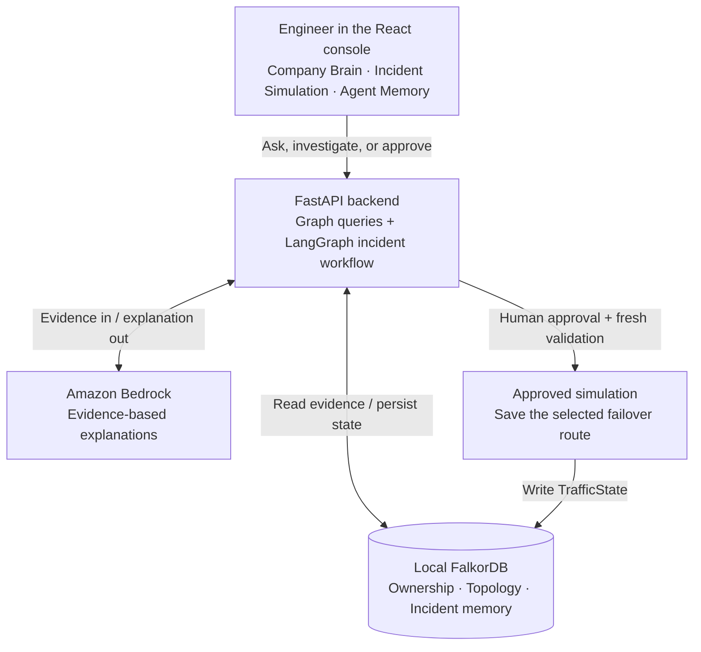

# ChronosOps

> **Graph-grounded incident intelligence: understand service ownership, investigate simulated outages, and remember prior outcomes.**

ChronosOps combines a React operator console, a FastAPI/LangGraph backend, local FalkorDB graphs and Amazon Bedrock explanations. Graph queries supply evidence and candidate routes; deterministic checks and human approval control simulated actions. It is not an autonomous production recovery system.

---

## At a Glance

| Feature | How FalkorDB Powers It | Track |
| :--- | :--- | :--- |
| **Blast Radius Calculation** | Traverses incoming `[:DEPENDS_ON*1..5]` reverse dependencies in `ops_topology` | **Track 01** |
| **Cost-Capped Failover Routing** | Evaluates candidate paths via `algo.SPpaths` with cost caps and node health checks | **Track 01** |
| **Human-in-the-Loop Safety Gate** | Binds action proposals to immutable graph hashes and 5-minute `ApprovalRecord` expiry | **Track 01** |
| **Episodic Recall Across Sessions** | Retrieves past incident outcomes from `agent_memory_{tenant}` without conversation history | **Track 02** |
| **Semantic Route Exclusions** | Queries active `[:BLOCKED_BY]->(:SemanticFact)` to block historically degraded routes | **Track 02** |
| **Stored Procedural Workflows** | Stores `WorkflowSubgraph` steps linked by `NEXT_STEP`; execution avoids fresh LLM planning but retains validation and approval | **Track 02** |
| **Canonical Ownership Citations** | Traverses `RELATES {rel_type:'OWNED_BY'}` and cites published SDK CSV row chunks | **Track 03** |
| **Contributor Concentration** | Counts validated source contributors; a knowledge-risk proxy, not measured bus factor | **Track 03** |

---

## Demonstration Video

Playable recordings of the running platform are available in the repository:
- `artifacts/chronosops-complete-demo.mp4` (11.3s, H.264 1440x1000): Complete workflow covering ownership inquiry, episodic memory recall, outage simulation, cost-capped failover proposal, human approval, and glass-box Cypher drawer inspection.
- `artifacts/chronosops-demo.mp4` (1m 44s, H.264 1440x1000): Comprehensive multi-scenario demonstration covering simulation approval, proposal rejection, WebSocket event streaming, and multi-tenant isolation.
- `artifacts/chronosops-operator-console.mp4` (42.6s, H.264 1440x1000): Detailed capture of the operator console, Cytoscape graph canvas, and execution traces.

---

## How It Works

An on-call engineer can ask who owns a service, investigate a simulated outage, and recall previous incident outcomes. The React console calls one FastAPI backend; FalkorDB supplies connected evidence and durable state, while Bedrock explains retrieved evidence.



**What the workflow actually does:** [`triage → remediation → governance`](agents/workflow.py) retrieves blast radius and prior memory, discovers candidate routes, then validates and saves a proposal. The engineer's approval is a separate API request; [`actions.py`](agents/actions.py) rechecks the proposal before changing simulation state. The resulting incident can then be consolidated into memory.

**What the model does not do:** Bedrock does not calculate dependency reachability, select authorized tenants, grant approval, or execute arbitrary commands. The incident workflow uses deterministic graph tools and validation, not an LLM planning loop. Runtime investigation tools use the official read-only FalkorDB MCP server; trusted persistence paths use the Python client.

**Demo boundary:** the console's failover changes graph state, not real network traffic. The separate EC2/SSM recovery integration is disabled in this demo; live Slack and real-recovery acceptance remain unverified. React/FastAPI and FalkorDB run locally in containers; Bedrock is the external model service.

### Graph Data Model

These are separate graphs in the same local FalkorDB instance, not three independent databases or services.

| Graph | Connected data | Why it matters |
| :--- | :--- | :--- |
| `company_brain` | Canonical services, teams and people; document chunks and publication provenance. SDK ownership/membership edges use `RELATES` with a `rel_type` property. | Answers “who owns this?” and “why was it designed this way?” with source citations. |
| `ops_topology` | Services linked by `DEPENDS_ON` and `ROUTES_TO`; incident, approval and `TrafficState` records. | Finds affected dependents and candidate failover routes; persists proposal and simulation state. |
| `agent_memory_acme` / `agent_memory_globex` | Incident episodes, decision logs, semantic exclusions and workflows whose steps link through `NEXT_STEP`. | Recalls past outcomes and routing constraints; stores ordered playbooks without relying on chat history. |

### How the Agent Queries the Graph

1. **Blast Radius (Track 01)**:
   ```cypher
   MATCH (s:Service {service_id: $service_id})<-[:DEPENDS_ON*1..5]-(dep:Service)
   RETURN DISTINCT dep.service_id AS affected_service
   ```
   *Agent action*: Computes exact downstream reachability without LLM guesswork.

2. **Cost-Capped Route Discovery (Track 01)**:
   ```cypher
   MATCH (s:Service {service_id: $source}), (t:Service {service_id: $target})
   CALL algo.SPpaths({
     sourceNode: s, targetNode: t, relTypes: ['ROUTES_TO'], weightProp: 'cost', maxLen: 5, pathCount: 5
   })
   YIELD path, pathCost
   WHERE pathCost <= $max_cost
   RETURN [n IN nodes(path) | n.service_id] AS route, pathCost
   ORDER BY pathCost ASC
   ```
   *Agent action*: Evaluates candidate paths and cost caps directly in the graph engine.

3. **Active Semantic Fact Exclusions (Track 02)**:
   ```cypher
   MATCH (f:SemanticFact {active: true, topology_version: $version, max_cost: $cap})
   RETURN f.subject AS subject, f.predicate AS predicate, f.object AS object, f.reason AS reason
   ```
   *Agent action*: Prunes previously degraded routes from recommendations based on persisted memory.

4. **Procedural Workflow Execution (Track 02)**:
   ```cypher
   MATCH (wf:WorkflowSubgraph {id: $wf_id})-[:CONTAINS_STEP]->(s:WorkflowStep)
   OPTIONAL MATCH (s)-[:NEXT_STEP]->(next:WorkflowStep)
   RETURN s.name, next.name, s.order
   ORDER BY s.order ASC
   ```
   *Agent action*: Executes verified operational playbooks with **zero LLM planning calls**.

5. **Company Brain Grounded Ownership (Track 03)**:
   ```cypher
   MATCH (s:Service {services__service_id: $service_id})-[:RELATES {rel_type: 'OWNED_BY'}]->(t:Team)
   OPTIONAL MATCH (p:Person)-[:RELATES {rel_type: 'MEMBER_OF'}]->(t)
   RETURN s.name AS service, t.name AS team, collect(p.name) AS members
   ```
   *Agent action*: Retrieves canonical service owners and team members grounded in signed CSV row chunks.
---

## Quick Start (Clean Clone)

### 1. Prerequisites
- Docker Compose or rootless Podman (`scripts/bootstrap-local.sh` auto-selects).
- `uv` Python package manager (`curl -LsSf https://astral.sh/uv/install.sh | sh`).
- Node.js 18+ and npm.

### 2. Boot FalkorDB and Bootstrap Local ACLs
```bash
./scripts/bootstrap-local.sh up -d db
```
Starts FalkorDB v4.22.1 with AOF persistence, 3000ms query timeout, and cryptographically generated ACL credentials stored in `.secrets/db.env`.

### 3. Install Dependencies and Build Frontend
```bash
uv sync --frozen
npm ci --prefix mcp --ignore-scripts
npm ci --prefix ui --ignore-scripts
npm run build --prefix ui
```

### 4. Seed Canonical Data and Topology
```bash
./scripts/seed.sh
```
Loads the 45-service microservice topology into `ops_topology`, canonical team/engineer mappings into `company_brain`, and sets up initial application constraints.

### 5. Launch the Operator Platform
```bash
./scripts/up.sh
```
Starts the full stack: application API (`:8000`), reverse proxy with basic authentication (`:8080`), database, and Prometheus monitoring.

---

## Running Demonstration Scenarios

Open the operator console in your browser at `http://localhost:8080`:

1. **Company Brain Inquiry**:
   - Select `payments-primary` from the dropdown.
   - Click **"Who owns this service?"** -> Click **"Query Company Brain"**.
   - *Result*: Returns Team Payments (`Ivan Vanko`, `Bob Martinez`, `Alice Chen`) with exact source citations from `services.csv`.

2. **Prior Incidents and Episodic Memory**:
   - Click **"Prior incidents?"** -> Click **"Query Company Brain"**.
   - *Result*: Queries `agent_memory_acme` for historical episodes and active route exclusion facts.

3. **Autonomous Outage Simulation**:
   - Click **"Simulate payments-primary outage"**.
   - *Result*: Downstream blast radius (4 services) is computed; `algo.SPpaths` selects the 8-cost route (`checkout -> queue -> payments-backup`) and rejects the 20-cost premium route.
   - Proposal banner appears with an immutable `ApprovalRecord` and 5-minute expiry countdown.

4. **Human-in-the-Loop Approval**:
   - Click **"Approve simulation"**.
   - *Result*: FalkorDB atomically merges `:TrafficState` and consolidates the episode into `agent_memory_acme`.

5. **Glass-Box Inspection**:
   - Expand the bottom **"Server-backed trace"** drawer.
   - *Result*: Inspect the actual OpenCypher statements executed, query parameters, and execution latencies in milliseconds.

---

## Test Suite and Verification

```bash
# Run all isolated default tests across all modules
pytest -q

# Run benchmark evaluation suite (graph-only query contracts)
uv run python -m tests.eval_suite --mode graph-only --output artifacts/eval-graph-only.json
```

- **Default Unit and Behavioral Suite**: 232 passed test cases across 32 test files covering atomic claims, lease concurrency, tenant boundaries, monitoring evidence, and memory consolidation.
- **Safety Invariant**: Real recovery requires explicit human approval on pinned SSM runbooks; zero unverified automated AWS mutations.
- **Multi-Tenant Isolation**: Separate `agent_memory_acme` and `agent_memory_globex` databases enforced by FalkorDB ACLs.
